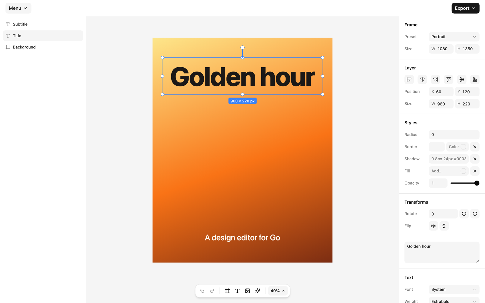

# atelier

A design editor for Go web applications, built from parts. Compose a canvas,
panels and a toolbar, edit frames, text and images, and add your own layer
types. The editor renders on the server with
[libhtml](https://github.com/alexisbcz/libhtml) and
[components](https://github.com/alexisbcz/components), and a small JavaScript
runtime makes it interactive. It needs no Node.js and no build step.



> Work in progress: expect the API to change.

## Features

- Select, move, resize and rotate layers, with snapping guides and marquee selection.
- Edit text in place, and drop or paste images onto the canvas.
- An inspector for position, size, radius, borders, shadows, fills, filters and typography.
- A layer tree with drag and drop, grouping, undo and redo, copy and paste, layer order, alignment and keyboard shortcuts.
- Pages, a library of Go templates, and sizes in pixels, inches, millimeters, centimeters or points at any DPI.
- Export to PNG, PDF (one page per document page) and JSON.
- Works on phones and tablets: the panels open as sheets, and two fingers zoom and pan.
- Custom layer types written in Go: the server renders them, in the editor too.
- AI image generation that runs on your machine, about a second per image.
- Saving through an HTTP handler, with memory and file stores and document validation.
- One embedded stylesheet for the editor and its components: no Tailwind setup needed.

## Install

```sh
go get github.com/alexisbcz/atelier
go mod tidy
```

## Quick start

```go
package main

import (
	"net/http"

	"github.com/alexisbcz/atelier"
	"github.com/alexisbcz/components/ui/runtime"
	h "github.com/alexisbcz/libhtml"
)

var doc = atelier.Document{Width: 1080, Height: 1080, Layers: []atelier.Layer{
	{ID: "title", Name: "Title", Type: "text", Value: "Hello", Vars: map[string]string{
		atelier.VarWidth: "800px", atelier.VarHeight: "200px",
		atelier.VarX: "140px", atelier.VarY: "440px", atelier.VarFontSize: "120px",
	}},
}}

func main() {
	http.Handle(runtime.Prefix, runtime.Handler())
	http.Handle(atelier.AssetsPrefix, atelier.Assets())
	http.HandleFunc("/", func(w http.ResponseWriter, r *http.Request) {
		editor := atelier.Designer(atelier.Config{Document: doc, Class: "h-svh"},
			atelier.Header(atelier.MainMenu(), h.Div(h.Class("flex-1")), atelier.ExportMenu()),
			atelier.Content(
				atelier.Panel(atelier.SideLeft, atelier.PaneLayers()),
				atelier.Canvas(atelier.Frame(), atelier.CanvasMenu()),
				atelier.Panel(atelier.SideRight,
					atelier.Pane("Layer", nil, atelier.ActionPosition(), atelier.ActionSize()),
					atelier.Pane("Text", []string{"text"}, atelier.ActionFontSize(), atelier.ActionColor()),
				),
			),
		)
		page := h.Html(h.Head(atelier.Stylesheet(), runtime.Scripts(r)), h.Body(editor))
		h.WriteHTTP(w, http.StatusOK, page)
	})
	http.ListenAndServe(":8080", nil)
}
```

Run the full demo with `go run github.com/alexisbcz/atelier/cmd/demo`.

## Documents and layers

A `Document` holds a frame size and a list of layers. Each `Layer` stores an
id, a name, a type, a value (the text of a text layer, the address of an
image) and CSS custom properties for its box and styles:

```go
atelier.Layer{ID: "logo", Type: "image", Value: "/logo.png", Vars: map[string]string{
	atelier.VarWidth: "320px", atelier.VarHeight: "120px", atelier.VarRadius: "12px",
}}
```

The stylesheet maps these properties to the rendering, so the server and
the browser draw a layer the same way. `StaticFrame` renders a document
read-only, for previews.

## Custom layer types

A layer type renders in Go. The editor fetches the rendering from the
handler, so custom types need no JavaScript:

```go
var badge = atelier.LayerType{
	Type: "badge", Name: "Badge", Key: "b",
	Defaults: atelier.Layer{Value: "New", Vars: map[string]string{
		atelier.VarWidth: "240px", atelier.VarHeight: "88px", atelier.VarFill: "#18181b",
	}},
	Render: func(l atelier.Layer) h.Node { return h.Span("✦ ", l.Value) },
}
```

Pass the types to `Config.Types` and to `Handler`, and set
`Config.RenderURL` to the handler's `render` path.

## Saving

`Handler` serves documents from a `Store` and validates what it saves. With
a `MediaStore`, it also stores uploaded and generated images:

```go
store := atelier.FileStore{Dir: "designs"}
http.Handle("/designs/", http.StripPrefix("/designs/", atelier.Handler(store, atelier.HandlerOptions{
	Types: atelier.Types{atelier.FrameType, atelier.TextType, atelier.ImageType, badge},
	Media: atelier.FileMedia{Dir: "media"},
})))
```

Set `Config.SaveURL` to `/designs/<id>` and `Config.UploadURL` to
`/designs/upload`: the editor posts the document after each change, and
uploads the images you drop or paste. Protect the handler like any write
endpoint, with a session check and CSRF protection.

## AI image generation

The Generate pane turns a prompt into an image layer. Generation runs on
your machine with
[stable-diffusion.cpp](https://github.com/leejet/stable-diffusion.cpp): with
SD-Turbo and the TAESD decoder, an image takes about a second on an Apple
M-series laptop, at no cost per image.

```sh
scripts/local-ai.sh                              # builds the server, fetches the models, serves on :7860
go run ./cmd/demo -sd http://127.0.0.1:7860
```

In your application, give the handler a generator and set
`Config.GenerateURL`. `SDServer` also edits images: the inspector's "Edit
with AI" action redraws the selected image from a prompt, keeping as much of
it as the strength allows (`Config.EditURL`):

```go
opts.Generator = atelier.SDServer{URL: "http://127.0.0.1:7860"}
// Config.GenerateURL: "/designs/generate", Config.EditURL: "/designs/edit"
```

Any type with a `Generate` method fits `ImageGenerator`, so other backends plug in. SD-Turbo allows
non-commercial use only. The server runs any Stable Diffusion or FLUX
model, so check the license of the model you choose.

## Actions and commands

Actions, the inspector controls, each edit one layer property. The package ships
actions for layout, styles, transforms, text and images, and the `Number`,
`Color`, `Select`, `Slider` and `Toggle` helpers build your own. Any element
with `atelier.Command(...)` runs an editor command when clicked, such as
undo, add a layer or export.

## Browser events

The editor root dispatches `atelier:change` with the document after each
change. The root element also exposes the editor, as `root.atelier`, for
scripts that need to read the document or the selection:

```js
const root = document.querySelector('[data-slot="atelier"]')
root.addEventListener("atelier:change", (e) => console.log(e.detail.document))
```

## Keyboard shortcuts

| Keys | Action |
| --- | --- |
| ⌘ Z, ⇧ ⌘ Z | Undo, redo |
| ⌘ C, ⌘ X, ⌘ V, ⌘ D | Copy, cut, paste, duplicate |
| ⌘ G, ⇧ ⌘ G | Group, ungroup |
| ⌫ | Delete |
| Arrows, ⇧ arrows | Nudge by 1 or 10 pixels |
| ⌘ ], ⌘ [ | Bring forward, send backward |
| ⌘ +, ⌘ −, ⌘ 0 | Zoom in, zoom out, zoom to fit |
| F, T, I | Add a frame, a text or an image |
| Space + drag | Pan |

On Windows and Linux, use the Control key in place of ⌘.

## License

MIT. See [LICENSE](LICENSE).
